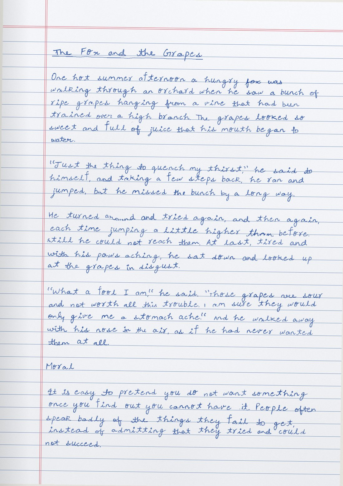

# handwritten

Turn a typed document into pages that look written by hand.



*An Aesop fable that was never written by hand, rendered on exercise-book paper with the bundled handwriting.*

- **Works out of the box.** A bundled handwriting set from the author's own writing is included: about 135 characters (letters, digits, maths and science symbols, Greek, accents) and 230 common whole words.
- **Learns a handwriting** from photos of notes, from a printable template, or from a font.
- **Maths and science ready.** Powers and formulas (`x^2`, `H_2O`), Greek letters, fractions, ticks and accented letters are drawn in the same hand, with super- and subscripts sized from the author's own writing.
- **Fast and offline.** A 40-page document renders in about 20 seconds on a laptop CPU. No GPU, no image model, no internet.
- **Works with AI assistants.** Use it as a Claude skill, or hand `AGENTS.md` to ChatGPT, Gemini, Cursor, Codex or any agent that can run Python.

## What it does

| | |
|---|---|
| Input | `.docx`, `.pdf` (with real text), `.md`, `.txt` |
| Output | One PDF of scanned-looking pages, plus optional PNGs |
| Paper | Exercise book (`notebook`), `ruled`, `plain` or `grid` |
| Ink | Blue, black, royal, red, or any `#RRGGBB` |
| Layout | Headings (underlined by hand), bullet and numbered lists, narrow tables, page breaks |
| Realism | Real whole-word samples with their joins, varied letter shapes, uneven baselines, drifting lines, pen-pressure changes, writing that loosens down the page, optional crossed-out slips, scan finish |
| Size control | Letter size, line spacing, or "fit this onto exactly N pages" |

There is no AI in the drawing. Every letter and many common words are real handwriting samples. A word that exists as a whole sample (such as "the", "and", "because") is placed as written, joins included. Every other word is built letter by letter. Each placement gets small random changes in size, tilt, spacing, height and ink, so the same word never looks stamped.

## Install

You need Python 3.9 or newer. For PDF input it also uses `pdftotext`/`pdftoppm` from poppler if they are installed.

```bash
git clone https://github.com/milarepa-gif/handwritten.git
cd handwritten
pip install -r requirements.txt
```

## Quick start

```bash
python handwrite.py notes.docx                      # writes notes_handwritten.pdf
python handwrite.py notes.docx out.pdf --notebook   # exercise-book look
python handwrite.py notes.docx out.pdf --pages 1    # render just page 1 first
python handwrite.py notes.md out.pdf --ink black --paper plain --messiness 1.3
```

`handwrite.py` converts the document to Markdown and renders it in one go. To tidy the text first, run the steps separately:

```bash
python scripts/doc_to_md.py notes.docx notes.md     # edit notes.md if you like
python scripts/render.py default notes.md out.pdf --paper notebook
```

**For the best result**, remove page numbers, running headers and images from the text, and turn wide tables into lists. Handwriting fits roughly 150 to 250 words a page, so expect more pages than the typed original, or use `--fit-pages N`.

## Maths, science and symbols

Write powers and formulas in the text and they come out raised or lowered, like this:

| You write | You get |
|---|---|
| `x^2`, `E = mc^2`, `10^-9`, `x^{n+1}` | x², mc², 10⁻⁹, xⁿ⁺¹ (raised) |
| `H_2O`, `CO_2`, `x_1`, `a_{ij}` | H₂O, CO₂, x₁, aᵢⱼ (lowered) |
| `x²`, `H₂O` (Unicode) | the same |

Only a number, one letter or a `{...}` group after `^` or `_` is raised or lowered, so `x^2y` is x²y. An underscore in ordinary words (`snake_case`) is left alone.

The bundled handwriting also draws these as real handwriting:

| | |
|---|---|
| Maths | `+ - = ± × ÷ ≠ ≤ ≥ ° % < >` and `{ } ( ) [ ] ~ \ ^ —` |
| Fractions | `½ ⅓ ¼ ¾` |
| Marks | `✓ ✗ ① ② ③ ★` |
| Greek | `α β γ δ θ λ μ σ φ ω Δ Σ Ω` |
| Currency | `₹ $` |
| Accents | `é è ê â à ô ö ü ï ñ ...` (composed from the letter and a real accent mark) |

Symbols a handwriting set doesn't have show as gaps (listed after rendering). A few are spelled out instead, such as `π` as "pi", `½` as "1/2" or `①` as "(1)". Use `--fallback-font` to fill the rest from a font, or add them to your set (next section).

### Add more symbols to a handwriting set

Write the symbols you need once or twice on ruled paper, next to a few capital letters (H, C, O, T), then photograph the page. If you want your super- and subscripts to match, also write `x²` and `H₂O` the way you normally would. This works for the bundled set and for your own.

```bash
python scripts/harvest.py segment work/ symbols.jpg           # numbers every mark it finds
# look at work/sheets/*.png and write work/labels.json, e.g.
#   {"p0.g12": "±", "p0.g30+g31": "\u00bd", "p0.g40": "cal:H", "p0.g41": "cal:H", "p0.g42": "cal:C"}
python scripts/add_symbols.py work/ my_hand/                  # or assets/default_hand
```

`cal:H` marks capitals used to measure your writing size (label at least three). The tool matches size and pen weight to the set, positions each symbol on the line, replaces old samples that are far off-size, and cuts accent marks off any accented letters so the renderer can put them on other letters. The label format is at the top of `scripts/add_symbols.py`.

## Use it with Claude

This repo is a Claude skill. `SKILL.md` holds the instructions.

**Claude Code**

```bash
git clone https://github.com/milarepa-gif/handwritten.git ~/.claude/skills/handwritten-docs
pip install -r ~/.claude/skills/handwritten-docs/requirements.txt
```

**Claude app (web or desktop)**

1. On GitHub choose Code > Download ZIP and unzip it.
2. Rename the folder inside from `handwritten-main` to `handwritten-docs`. The folder name must match the skill name in `SKILL.md`.
3. Zip that folder again.
4. In Claude, go to Customize > Skills, click **+**, choose **Create skill**, then **Upload a skill**, and upload the zip. Code execution must be turned on in your settings.

Then attach a document and ask: *"make this look handwritten in a notebook"*. Claude tidies the text, shows you page 1, and renders the full PDF.

## Use it with ChatGPT, Gemini, Cursor, Codex or other agents

Any assistant that can run Python works. `AGENTS.md` tells it exactly what to do.

- **ChatGPT or Gemini with code execution:** upload the repo zip and your document, then paste:
  > Unzip the repo zip, read AGENTS.md inside it and follow it to turn my document into a handwritten PDF. Show me page 1 first.

  If pip installs are blocked, everything except `python-docx` is usually preinstalled. Give it a `.pdf` or `.txt` instead of `.docx`.
- **Cursor, Codex, Windsurf, Aider and other coding agents:** open the repo and ask it to render your file.

## Use your own handwriting

You can only use handwriting you wrote yourself or have permission to copy. See [Responsible use](#responsible-use).

### Option A: photos of notes you already have

Give it 3 to 8 clear photos of pages written in pen, straight on and in good light. Ruled lines, margins, shading, page curl and tilt are cleaned up automatically. An extra page with a to z, A to Z and 0 to 9 in your normal style helps with letters that don't appear in the notes.

```bash
# 1. Clean the photos and draw numbered sheets of the lines
python scripts/harvest.py segment work/ alphabet.jpg page1.jpg page2.jpg --lines-only

# 2. Write down what each line says in work/labels.json:
#    {"p1.L3.t": "the price of a good falls, so",
#     "p0.L2.g": "A a B b C c"}
#    "?" skips a word you don't want (crossed out, smudged). An AI assistant can read
#    the sheets and write this file for you.

# 3. Build the handwriting set
python scripts/harvest.py build work/ my_hand/ --word-space 1.6 --letter-space 0.12

# 4. Use it
python handwrite.py notes.docx out.pdf --hand my_hand/
```

Check `my_hand/review_words.png` and `my_hand/review_letters.png`. To throw out a bad sample, add it to a `"_drop"` list in `labels.json` (for example `"_drop": ["water@p3.L7"]`; the source of each sample is stored in `my_hand/glyphs.json`) and build again. The full label format is at the top of `scripts/harvest.py`.

Only the words you label are kept. Don't label anything you wouldn't want inside a shared file, such as names, ID numbers, signatures or addresses.

### Option B: the printable template

1. Print `assets/handwriting_template.pdf` on A4 at 100% ("Actual size").
2. Write one character in each box, sitting on the blue line, with the same dark pen throughout.
3. Photograph each page straight on with all four black corner squares in frame. Order and rotation don't matter.

```bash
python scripts/extract_glyphs.py my_hand/ IMG_1.jpg IMG_2.jpg IMG_3.jpg IMG_4.jpg
python handwrite.py notes.docx out.pdf --hand my_hand/
```

No labelling is needed because the boxes say which character is which.

### Option C: a handwriting font

```bash
python scripts/font_to_glyphs.py SomeHandwritingFont.ttf my_hand/
```

## Options

These work with both `handwrite.py` and `scripts/render.py`. Run `python scripts/render.py -h` for the full list.

| Option | Default | What it does |
|---|---|---|
| `--notebook` | off | Exercise-book preset (`handwrite.py` only) |
| `--hand DIR` | `default` | Which handwriting to use (`handwrite.py` only) |
| `--paper` | `ruled` | `ruled`, `notebook`, `plain` or `grid` |
| `--ink` | `blue` | `blue`, `black`, `royal`, `red` or `#RRGGBB` |
| `--size` | `2.6` | Height of small letters (a, e, o) in mm |
| `--line` | `8` | Line spacing in mm |
| `--messiness` | `1.0` | 0 is tidy, 1 is normal, 2 is rushed |
| `--fatigue` | `0.25` | How much looser the writing gets toward the bottom of a page |
| `--corrections` | `0` | Chance per long word of a crossed-out slip before it (try `0.01`) |
| `--slant` | `0` | Extra lean in degrees; positive leans right |
| `--letter-space`, `--word-space` | from the hand | Gaps between letters and words |
| `--indent`, `--para-gap` | `6`, `0` | Paragraph indent (mm) and blank lines between paragraphs |
| `--margins` | `22,12,14,24` | Top, right, bottom, left in mm |
| `--fit-pages N` | off | Scale the writing so the document lands on N pages |
| `--pages 1-3` | all | Render only some pages |
| `--no-scan` | off | Skip the scanned look |
| `--no-words` | off | Build every word from letters |
| `--fallback-font` | none | Font for characters with no sample |
| `--dpi`, `--quality` | `150`, `72` | Resolution and JPEG quality per page |
| `--png-dir DIR` | off | Also save each page as a PNG |
| `--seed` | `1` | Change for a different random variation |

## Limits

Known limits, from testing:

- **Characters.** The bundled handwriting covers letters, digits, punctuation, common maths and science symbols, Greek letters and most Latin accents (see above). It has no `π √ ∞ ∴ ≈ € £ © ®`, no `ç å`, and no non-Latin scripts. Those are spelled out or left as gaps and listed in the output. Pass `--fallback-font some.ttf` to fill them, or add them with `scripts/add_symbols.py`.
- **Maths layout is inline only.** There are no stacked fractions (write `a/b`), square-root bars, matrices or integral limits.
- **Only about 20 to 30% of words use a whole-word sample.** The rest are built letter by letter, so the look is closest to the original on common words and a little more "assembled" elsewhere. A heavily joined cursive hand is only partly reproduced.
- **Images, charts and equations are not drawn.** Rewrite complex tables and maths as text first. Bold, italics and colour are dropped.
- **Scanned PDFs can't be read.** A PDF made of page images has no text; use the original document, or retype or OCR it into a `.txt` first.
- **It looks like handwriting, not a specific person's** unless you build a set from their notes. Close inspection of long documents can reveal repeated letter shapes.

## Responsible use

This makes typed text look handwritten. Don't use it to submit work that is required to be handwritten, to pass off pages as someone else's writing, or to imitate a real person's handwriting without their permission (for example on forms, letters or signatures). Handwriting sets you build contain samples of a person's actual writing; treat them as personal data and don't share them without consent.

## Repository layout

```
handwrite.py                    one command: document -> handwritten PDF
SKILL.md                        instructions for Claude
AGENTS.md                       instructions for any other AI agent
assets/default_hand/            bundled handwriting (letters and whole words)
assets/handwriting_template.pdf printable template for your own handwriting
scripts/render.py               Markdown -> handwritten PDF
scripts/doc_to_md.py            .docx/.pdf/.txt -> Markdown
scripts/harvest.py              photos of notes -> handwriting set
scripts/add_symbols.py          photos of symbols -> added to a handwriting set
scripts/pageclean.py            photo cleaning (ruled lines, shading, tilt)
scripts/extract_glyphs.py       filled template -> handwriting set
scripts/font_to_glyphs.py       font -> handwriting set
scripts/make_template.py        regenerate the template
examples/                       sample output
tests/smoke_test.py             end-to-end check: python tests/smoke_test.py
tests/simulate_filled_template.py  fake template photos for testing
```

## License

MIT. See `LICENSE`. The bundled handwriting samples in `assets/default_hand/` are the author's own and are released under the same license.
